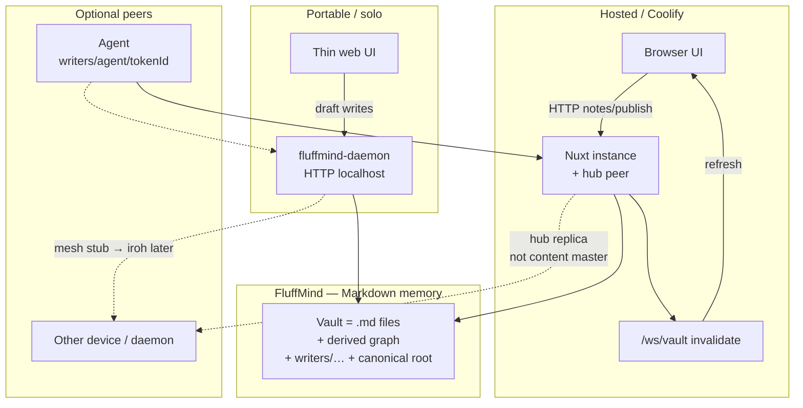
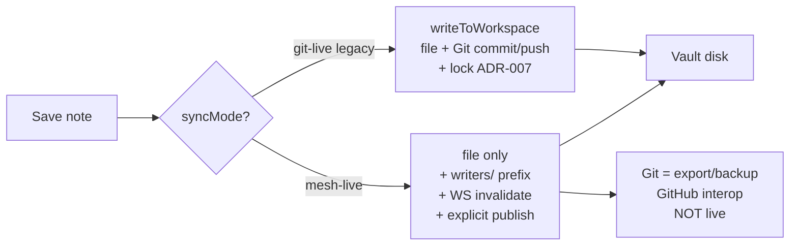
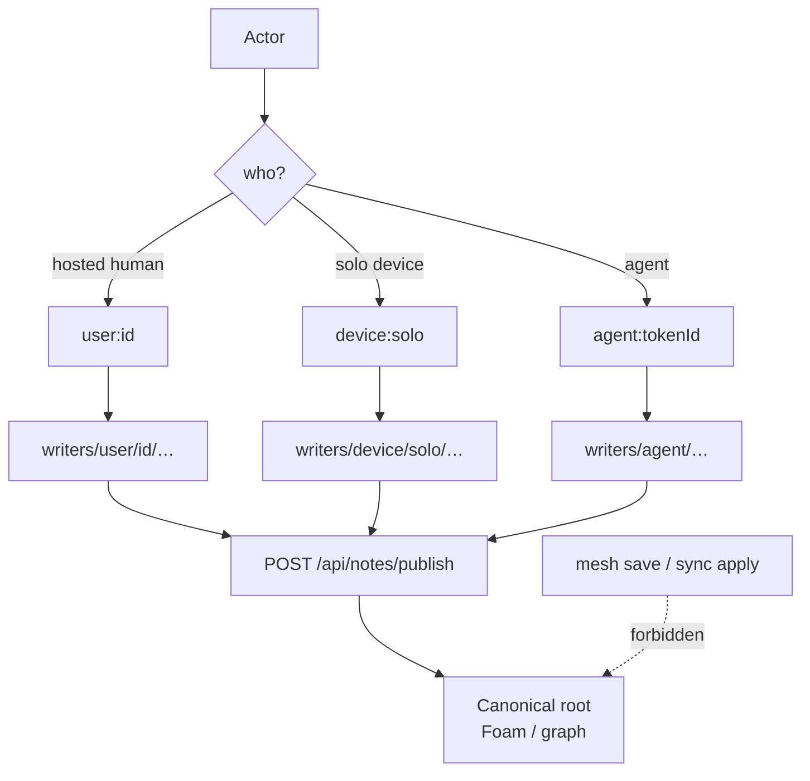
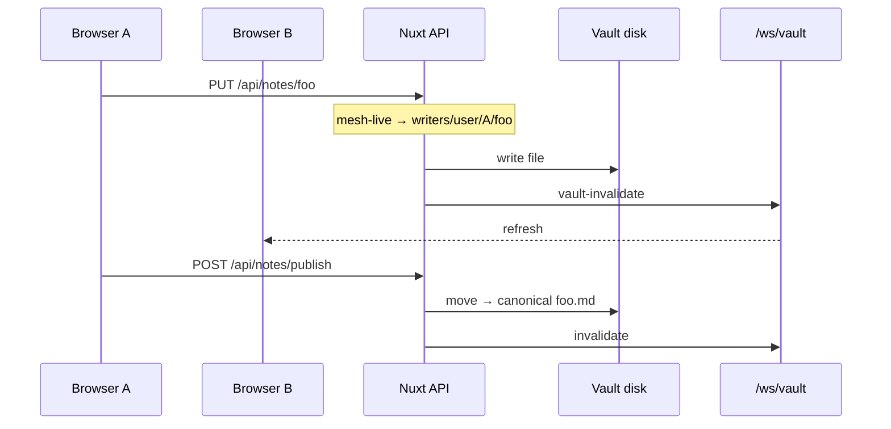
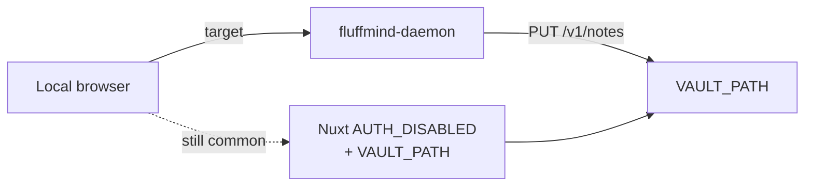
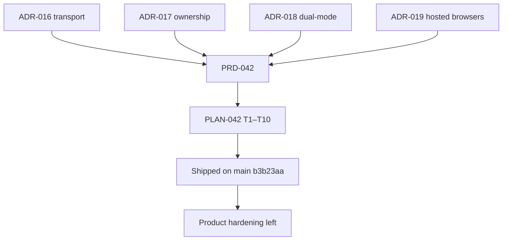

# Sync architecture — portable vs hosted

#architecture #data #sync

- **Status**: reference map for PRD-042 (shipped slices T1–T10 on `main`)
- **Date**: 2026-11-14
- **Resume here** after a long sync session — diagrams + gaps + next moves

Related: [[rethink-sync|Rethink sync]], [[vault-engine|Vault engine]],
[[../../prd/PRD-042-sync-rethink|PRD-042]], [[../../plans/PLAN-042-sync-rethink|PLAN-042]],
[[../decisions/ADR-016-live-sync-transport|ADR-016]] …
[[../decisions/ADR-019-hosted-multi-browser-coherence|ADR-019]],
explore map [#141](https://github.com/chatondearu/fluffmind/issues/141).

## One-line model

**Host** = UI + Nuxt instance (hub replica) + vault + `/ws/vault`.  
**Portable** = UI + local daemon + vault (+ optional host).  
**Both** = drafts under `writers/…`, canonical root only via **publish**, Git = backup
(not live master).

## Facades (portable vs hosted)

## Dual-mode: `git-live` vs `mesh-live`

| | **git-live** (default) | **mesh-live** (target) |
| -- | -- | -- |
| Live write | Server Git | Files + ownership |
| Conflicts | Lock | `writers/` layout |
| Multi-browser | Lock / 503 | WS invalidate |
| Opt-in | — | `PATCH /api/workspaces/sync-mode` or env `SYNC_MODE` |

## Path ownership + publish

Encoding: logical `kind:id` → on-disk `writers/<kind>/<id>/…` (`writer-prefix.ts`).

## Hosted runtime sequence

Auth / GitHub App / content roots stay **orthogonal**: they gate *who may manage* a
workspace, not *who wins* on a path (ownership does).

## Portable today vs target

**Gap:** daemon HTTP exists (`scripts/fluffmind-daemon.mjs --self-check`); Nuxt UI is
**not** yet the thin client exclusively talking to the daemon.

## Decision stack

## Shipped vs remaining (session handoff 2026-11-14)

### Done

- Explore map [#141](https://github.com/chatondearu/fluffmind/issues/141) → ADR-016…019
- PLAN-042 **T1–T10** (mode, mesh write, writers, publish, WS, hosted writer, daemon,
  in-memory mesh stub, sync-mode API/UI, docs)
- Commit `feat(sync): implement mesh-live dual-mode sync rethink (PRD-042)` on `main`

### Hardening H1–H3 (graph run 2026-11-14)

Landed uncommitted on working tree (run `cursor-fallback-20261114T122534Z-669242`):

| Task | Result |
| ---- | ------ |
| H1 UI↔daemon | `NUXT_PUBLIC_DAEMON_URL` → `/__daemon` proxy → autosave PUT daemon |
| H2 transport | Localhost **TCP** hub behind `MeshSyncTransport`; iroh still deferred |
| H3 folders | mesh-live create/rename/delete skip Git + WS invalidate |

### Still to do (product feel / next sessions)

| Priority | Gap | Why |
| -------- | --- | --- |
| High | Wire Nuxt/daemon apply to `MeshSyncTransport` (TCP ready) | Live mesh not on save path yet |
| High | Real iroh + relay (when allowBuilds ok) | Multi-device / NAT |
| Medium | Operator smoke: opt-in sync-mode + dogfood | Validate dual-mode |
| Later | Same-note CRDT | Out of PRD-042 |
| Later | Supersede ADR-002 after real migrates | Per ADR-018 |

### Suggested next session (pick one)

1. **Apply path → TCP mesh** (daemon/Nuxt publish updates on transport).
2. **Operator smoke** mesh-live + portable daemon dogfood.
3. **iroh** when ready to touch package.json / allowBuilds.

Breadcrumb: *H1–H3 done — suite = brancher apply→MeshSyncTransport OU smoke dual-mode.*

## Code map (quick)

| Concern | Where |
| ------- | ----- |
| syncMode | `apps/web/server/vault/sync-mode.ts`, DB `workspace_config.sync_mode`, `SYNC_MODE` |
| mesh write / writers | `write.ts`, `writer-prefix.ts`, `hosted-writer.ts`, `mesh-write.ts` |
| publish | `publish.ts`, `POST /api/notes/publish` |
| WS invalidate | `vault-invalidate.ts`, `/ws/vault`, `useVaultInvalidate` |
| migrate API | `GET\|PATCH /api/workspaces/sync-mode`, `WorkspaceSyncModeSection` |
| daemon | `scripts/fluffmind-daemon.mjs`, `apps/web/server/daemon/` |
| mesh stub / TCP hub | `packages/integrations/src/mesh/` (`InMemoryMeshHub`, `startTcpMeshHub`) |
| UI↔daemon | `useDaemonNotes`, `nuxt.config` `/__daemon`, `NUXT_PUBLIC_DAEMON_URL` |
| folder mesh-live | `folders.ts`, `mutations.commitMutation` |
