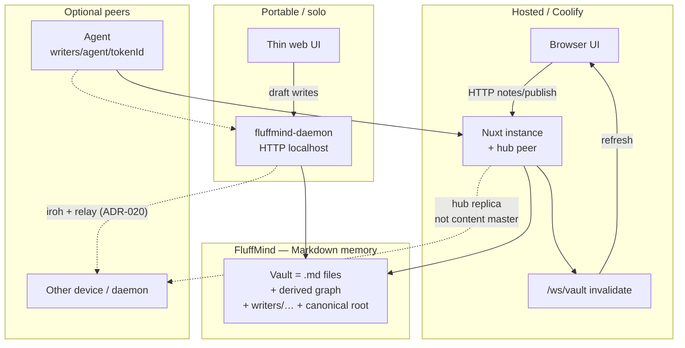
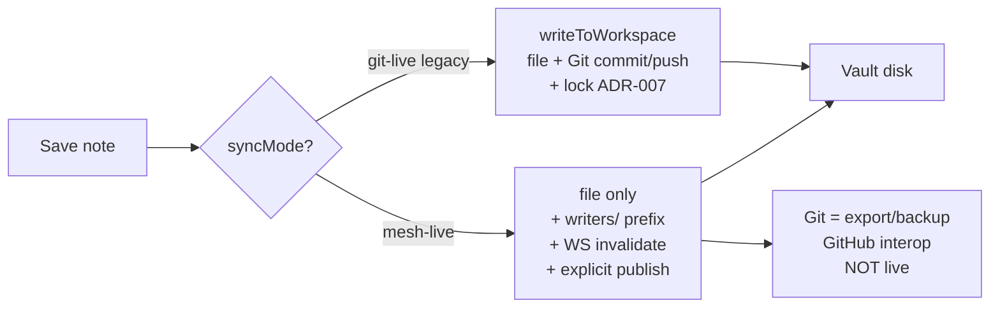
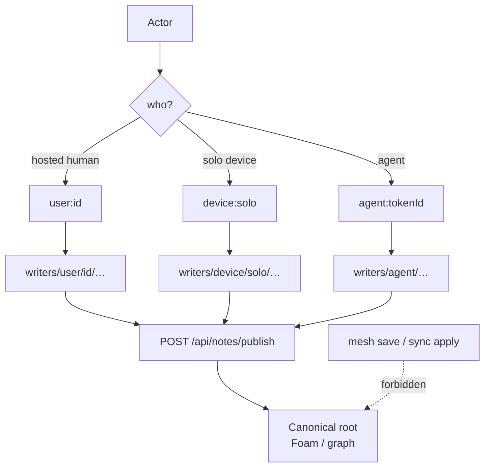
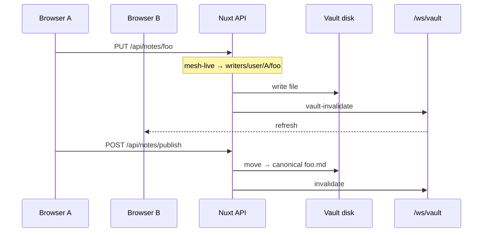
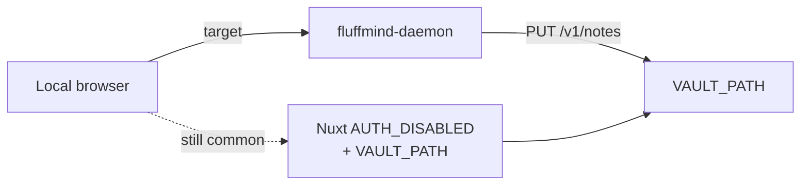
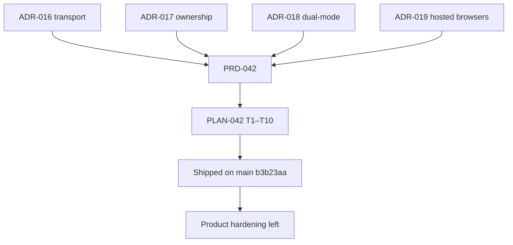
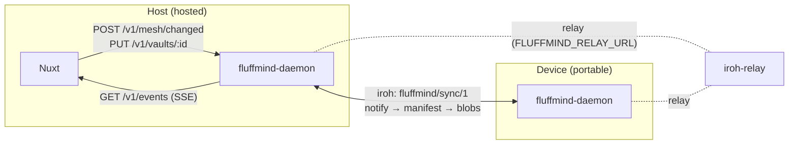

# Sync architecture — portable vs hosted

#architecture #data #sync

- **Status**: reference map for PRD-042 (shipped slices T1–T10 on `main`)
- **Date**: 2026-11-14
- **Resume here** after a long sync session — diagrams + gaps + next moves

Related: [[rethink-sync|Rethink sync]], [[vault-engine|Vault engine]],
[[../../prd/PRD-042-sync-rethink|PRD-042]], [[../../plans/PLAN-042-sync-rethink|PLAN-042]],
[[../decisions/ADR-016-live-sync-transport|ADR-016]] …
[[../decisions/ADR-019-hosted-multi-browser-coherence|ADR-019]],
explore map [#141](https://github.com/chatondearu/fluffmind/issues/141).

## One-line model

**Host** = UI + Nuxt instance (hub replica) + vault + `/ws/vault`.  
**Portable** = UI + local daemon + vault (+ optional host).  
**Both** = drafts under `writers/…`, canonical root only via **publish**, Git = backup
(not live master).

## Facades (portable vs hosted)

## Dual-mode: `git-live` vs `mesh-live`

| | **git-live** (default) | **mesh-live** (target) |
| -- | -- | -- |
| Live write | Server Git | Files + ownership |
| Conflicts | Lock | `writers/` layout |
| Multi-browser | Lock / 503 | WS invalidate |
| Opt-in | — | `PATCH /api/workspaces/sync-mode` or env `SYNC_MODE` |

## Path ownership + publish

Encoding: logical `kind:id` → on-disk `writers/<kind>/<id>/…` (`writer-prefix.ts`).

## Hosted runtime sequence

Auth / GitHub App / content roots stay **orthogonal**: they gate *who may manage* a
workspace, not *who wins* on a path (ownership does).

## Portable today vs target

**Gap:** the daemon now ships in every portable archive and the launcher wires the UI to it,
but Nuxt UI is **not** yet the thin client exclusively talking to the daemon (the Nuxt vault
API stays for reads and non-daemon paths).

## Decision stack

## Shipped vs remaining (session handoff 2026-11-14)

### Done

- Explore map [#141](https://github.com/chatondearu/fluffmind/issues/141) → ADR-016…019
- PLAN-042 **T1–T10** (mode, mesh write, writers, publish, WS, hosted writer, daemon,
  in-memory mesh stub, sync-mode API/UI, docs)
- Commit `feat(sync): implement mesh-live dual-mode sync rethink (PRD-042)` on `main`

### Hardening H1–H3 (graph run 2026-11-14)

Landed uncommitted on working tree (run `cursor-fallback-20261114T122534Z-669242`):

| Task | Result |
| ---- | ------ |
| H1 UI↔daemon | `NUXT_PUBLIC_DAEMON_URL` → `/__daemon` proxy → autosave PUT daemon |
| H2 transport | Localhost **TCP** hub behind `MeshSyncTransport` — removed in #151, replaced by iroh in the Rust daemon |
| H3 folders | mesh-live create/rename/delete skip Git + WS invalidate |

### Still to do (product feel / next sessions)

Runtime decided 2026-11-17: **Rust `fluffmind-daemon` + iroh**
([[../decisions/ADR-020-rust-daemon-iroh-transport|ADR-020]]). Recommended order:

| Order | Gap | Issue / plan | Why |
| ----- | --- | ------------ | --- |
| ✓ | Rust daemon, HTTP parity; Node daemon retired | [#150](https://github.com/chatondearu/fluffmind/issues/150) · [[../../plans/PLAN-150-rust-daemon-parity|PLAN-150]] | Swap runtime under an unchanged contract |
| ✓ | Real iroh + relay behind `MeshSyncTransport`; TCP hub deleted | [#151](https://github.com/chatondearu/fluffmind/issues/151) · [[../../plans/PLAN-151-iroh-transport-relay|PLAN-151]] | Multi-device / NAT / offline catch-up (see "Mesh daemon" below) |
| ✓ | Package: portable sidecar, Coolify `sync` + `relay` services | [#152](https://github.com/chatondearu/fluffmind/issues/152) · [[../../plans/PLAN-152-daemon-packaging|PLAN-152]] | Users get it without dev setup (see "Packaging" below) |
| ✓ | Operator smoke mesh-live + daemon dogfood | [#155](https://github.com/chatondearu/fluffmind/pull/155) | Done: `pnpm --filter @fluffmind/web run test:mesh-smoke` (now over `InMemoryMeshHub`: apply → WS → publish; rogue canonical rejected; git-live ↔ mesh-live rollback). Real iroh coverage lives in `cargo test` (`tests/mesh.rs`, `tests/mesh_http.rs`) |
| Later | Same-note CRDT | — | Out of PRD-042 |
| Later | Supersede ADR-002 after real migrates | — | Per ADR-018 |

Mesh apply rejects canonical paths and ignores updates on git-live workspaces
(ADR-017); peer-to-writer binding tracked in [#154](https://github.com/chatondearu/fluffmind/issues/154).

### Packaging (PLAN-152)

- **Portable**: every archive bundles `bin/fluffmind-daemon` (native build per OS runner;
  linux-x64 static musl). The launcher starts it on `127.0.0.1:8787`, waits for `/health`,
  exports `NUXT_PUBLIC_DAEMON_URL`, starts Nuxt, and stops both on exit. `--no-daemon` keeps
  Git-live solo; `--readonly` skips the daemon (its API has no read-only gate).
- **Hosted / Coolify**: `sync` service (Dockerfile target `daemon`, static musl) beside `web`,
  same volumes + `sync-data` for the node key, internal network only, generated bearer token;
  optional `relay` service (`iroh-relay` at the pinned version, plain HTTP behind the Coolify
  proxy) enabled with the `relay` compose profile.

### Suggested next session

Follow-ups noted in ADR-020 "Implementation notes" (allow-list gossip for device↔device
through the host, peer revocation, Nuxt enrol UI, initial scan of pre-existing files), and
the manual cross-network relay check (needs a deployed relay).

## Code map (quick)

| Concern | Where |
| ------- | ----- |
| syncMode | `apps/web/server/vault/sync-mode.ts`, DB `workspace_config.sync_mode`, `SYNC_MODE` |
| mesh write / writers | `write.ts`, `writer-prefix.ts`, `hosted-writer.ts`, `mesh-write.ts` |
| publish | `publish.ts`, `POST /api/notes/publish` |
| WS invalidate | `vault-invalidate.ts`, `/ws/vault`, `useVaultInvalidate` |
| migrate API | `GET\|PATCH /api/workspaces/sync-mode`, `WorkspaceSyncModeSection` |
| daemon | `crates/fluffmind-daemon/` (Rust, ADR-020; contract smoke `scripts/daemon-contract-smoke.mjs`; writer-prefix case table `crates/fluffmind-daemon/tests/fixtures/writer-cases.json`, read by cargo test and `writer-cases.test.ts`) |
| mesh transports | `packages/integrations/src/mesh/` (`InMemoryMeshHub` for tests, `DaemonMeshTransport` + `putDaemonVault` for the Rust daemon) |
| mesh peer (iroh) | `crates/fluffmind-daemon/src/mesh/` (`entry` signed entries + apply policy, `ticket` enrolment, `proto` wire types, `mod` endpoint + notify-then-pull, `vault` persisted state) |
| apply path | `mesh-apply.ts` (`persisted` events only invalidate), `mesh-peer-bootstrap.ts` (config push + binding), plugin `mesh-peer` |
| UI↔daemon | `useDaemonNotes`, `daemon-proxy.ts` (`/__daemon` Nitro route, checked per request, portable/solo only), `NUXT_PUBLIC_DAEMON_URL`, `FLUFFMIND_DAEMON_TOKEN` |
| folder mesh-live | `folders.ts`, `mutations.commitMutation` |

## Mesh daemon (PLAN-151)

- **Enrol**: `fluffmind-daemon ticket --writer device:laptop` on one side prints a ticket
  (`fm1.…`: EndpointId + relay + vault id + one-time code, 15 min, single use, rate limited);
  `fluffmind-daemon enrol <ticket>` on the other redeems it. Each side records the other in the
  vault allow-list with the writers it may author and a `canPublish` grant (devices: no by
  default; a host passes `--self-can-publish` so its publishes are accepted).
- **Sync**: a change makes the origin send `Changed`; peers pull the manifest (signed entries),
  keep entries that pass the apply policy and win LWW, fetch blobs (BLAKE3 checked against the
  signed hash) and write atomically. Fallback pull on startup, on attach and every
  `FLUFFMIND_SYNC_INTERVAL_SECS` (60 s).
- **Apply policy** (per entry): origin in the allow-list, signature valid for this vault,
  `writers/<kind>/<id>/` only for a writer that origin may author, root paths only when
  `published` **and** the origin has `canPublish`, content roots respected.
